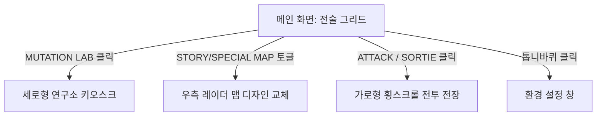
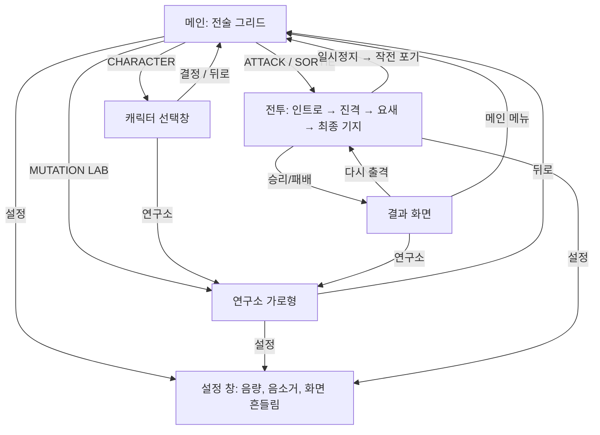

# 메인 화면 UI/UX 기획서 (Main Menu UI/UX Specification)

이 문서는 프로젝트 **매드 오버로드 (MAD OVERLORD)**의 메인 전술 화면의 UI/UX 설계 및 레이아웃 배치안을 명세합니다.

---

## 1. 개편된 전술 그리드 레이아웃 (Tactical Grid Layout v2)

V의 피드백을 반영하여 복잡한 메뉴 바를 배제하고, 좌측의 몬스터 관리 영역과 우측의 전장 맵 타겟팅 영역으로 직관화한 설계안입니다.

### 🖼️ 시안 이미지 참조
* **[최종 개편 시안 B v2](file:///e:/Project/SelfMovingGame/MD/ui_draft_b_v2.png)**
* **[초기 디자인 시안 B v1](file:///e:/Project/SelfMovingGame/MD/ui_draft_b_v1.png)**

---

## 2. 화면 영역별 구성 명세

### ① 좌측 패널: 오버로드 대기실 (Overlord Showroom)
* **몬스터 Live2D 모델링**: 현재 조립/장착된 파츠가 결합된 완성형 몬스터가 숨쉬기(Idle) 모션으로 렌더링됩니다.
* **[MUTATION LAB] 버튼**: 
  - 위치: 몬스터 모델링 바로 하단.
  - 기능: 클릭 시 세로형 연구실 파츠 장착 및 스탯 강화 키오스크 화면으로 줌인 전환됩니다.

### ② 우측 패널: 홀로그램 전술 레이더 (Tactical Radar Map)
* **홀로그램 전장 지도**: 현재 구역의 성을 중심으로 공격 타겟 포인트와 거점 도달 경로가 표시됩니다.
* **스테이지 맵 토글 버튼 (2종)**:
  - **[STORY MAP]**: 시나리오 전개를 위한 기본 1-1, 1-2 등 스토리 진격 맵 활성화.
  - **[SPECIAL MAP]**: 타임어택이 배제된 성장용 '무제한 파밍 스테이지' 및 보스 레이드 랭킹전용 '엘리트 챌린지 스테이지' 맵 활성화.

### ③ 하단 중앙: 작전 출격 통제 패널 (Main Action Panel)
* **[협력 출격] 버튼** (2026-10-26, D-087): ATTACK 왼쪽에 편성한 캐릭터의 얼굴·이름·간략 효과를 표시한다. 수동 Q 문구는 생략한다. 미선택이며 편성 가능한 후보가 있을 때만 은은한 빛 효과로 선택을 유도한다(동작 줄이기 설정에서는 고정 강조). 후보가 없으면 캐릭터 해금·보유 파츠 4부위 조건을 안내한다. 편성 창에서는 선택된 캐릭터만 밝은 테두리·배경 및 **✓ 선택됨** 배지를 표시한다.
* **[ATTACK / SORTIE] 버튼**:
  - 위치: 화면 중앙 최하단.
  - 디자인: 빗금 형태의 노란색/검은색 위험(Warning) 공사 스트라이프 무늬로 제작하여 시각적 강조 극대화.
  - 기능: 클릭 시 선택한 스테이지 가로형 횡스크롤 전투 전장으로 출격합니다.

### ④ 우상단: 설정 및 정보 영역 (Utility & Top Bar)
* **세재화 정보**: 보유하고 있는 일반 재화 및 특수 재화 인디케이터.
* **[세팅] 버튼 (톱니바퀴 아이콘)**: 
  - 기존 하단 푸터 바에 있던 복잡한 세팅 버튼을 우상단으로 깔끔하게 통합하여 화면 개방감을 높였습니다.

---

## 2-1. 가로형 적용 (2026-09-30, D-010) — 현재 구현

시안 B v2(세로 구성)를 **가로 1280x720**으로 옮겼다. 코드: `js/ui_v2/menu_v2.js`, `radar_v2.js`, `lab_v2.js`, `ui_v2.css` 8·9장.

**메인 화면**
| 위치 | 구성 |
|---|---|
| 위 | 왼쪽 문장·게임 이름 / 오른쪽 DM, 설정(톱니바퀴) |
| 왼쪽 패널 ① | 캐릭터 이름·팩션(머리표 UNIT READY / 몸통이 없으면 NO BODY), 리그 캐릭터(대기 동작, 안 산 부위는 흐리게), 부위별 설명(머리·팔·몸통·다리: 파츠 이름 + 스킬), 능력치 4개, **CHARACTER**(선택창) · **MUTATION LAB** 버튼 |
| 오른쪽 패널 ② | 전술 레이더(지형 등고선, 회전 탐지선, 진격 경로, 목표·적 신호), STORY / SPECIAL MAP 전환 (SPECIAL은 준비 중으로 잠금 → 출격 버튼 꺼짐). 레이더 머리에 **구역 탭**(구역 1 / 구역 2, 잠긴 구역은 자물쇠 — 누르면 "잠김" 안내), 고른 구역의 스테이지 점만 표시 (2026-10-03, D-041) |
| 아래 ③ | **ATTACK / SORTIE** 버튼(몸통이 없으면 막힘 — "출격 불가" 안내), 상태 줄(DM, 장착 스킬, 출격 가능 여부) |

**캐릭터 선택창** (2026-10-14, D-051)
| 위치 | 구성 |
|---|---|
| 위 | 뒤로(메인), 제목, DM, 설정 |
| 가운데 | 캐릭터 카드 4장(새 캐릭터와 합치면 8장): 영문 태그·이름, 리그 캐릭터(그 캐릭터의 장착, 안 산 부위는 흐리게), 소개 한 줄, 능력치 3개, 스킬 1·2·필살기·패시브, 보유 파츠 수, 출격 가능 / 연구소에서 몸통 구매. 누르면 바로 그 캐릭터로 바뀜(SELECTED) |
| 아래 | 고른 캐릭터·보유 파츠·안내, **연구소**, **결정**(메인 화면) |

**연구소** (기획서의 "세로형 키오스크"를 가로형으로)
| 위치 | 구성 |
|---|---|
| 위 | 뒤로(메인), 제목, DM, 설정 |
| 왼쪽 | 개조 미리보기: 고른 파츠로 조립한 리그 캐릭터 (캐릭터는 선택창에서 고른 캐릭터, 안 산 부위는 흐리게) |
| 가운데 | 능력치 비교(현재 → 개조 후, ▲▼), 스킬 구성(스킬 1·2·필살기·패시브, 바뀌면 NEW) |
| 오른쪽 | 부위 탭(머리·몸통·팔·다리) + 파츠 카드(부위 그림, 캐릭터 색, 세트, 능력치, 부여 스킬, 가격·장착 상태) — **고른 캐릭터의 파츠만, [파츠제거] 없음** (D-051) |
| 아래 | 변경 수, 개조 비용, 개조 후 잔액, 되돌리기, **개조 확정** |

**전투 화면**: HUD(유닛 카드, 진행도, 거점 체력, 스킬 도크, 일시정지·배속), 연출(인트로, 경고, 컷인, 파괴, 결과 화면). 일시정지 메뉴에 설정.

> 협력 호출 현재 설정(D-075): 첫 충전·재충전은 각각 30초이며, HUD·편성·상세 안내도 공통 설정을 따른다.

**협력 출격 HUD** (2026-10-22, D-072·D-073): **좌측 상단 주인공 상태창 바로 아래** 350px 가로형 카드. 64px 팔각 초상화에 충전 부채꼴·남은 초·Q 단축키를 표시한다. 옆에는 이름과 간략 상태(`첫 충전 / 재충전 / 호출 가능 / 대상 대기 / 지원 중`), 다음 줄에 간략 효과, 아래에 효과 상세·독립 자동 토글을 배치한다. 상태 옆 초 표시는 제거하고 남은 시간은 버튼 안에만 둔다. **효과 상세**를 누르면 같은 상단 자리에서 카드 대신 요약·필살기·전체 효과·시너지·보스 예외를 펼친다. 높이 230px 이내·내부 스크롤로 주인공·거점/보스 바·기존 스킬을 가리지 않는다. 상세가 열리면 가려진 카드 조작을 숨기고 닫기로 포커스를 옮긴다. 닫기/바깥 클릭/Escape로 닫으며, 닫기/Escape 후 상세 버튼으로 포커스를 돌려준다. 설명 열기는 호출이나 일시정지를 유발하지 않는다. 첫 충전/재충전 30초(D-075)·5초 출격 규칙을 따른다. 규칙은 [협력모드 컨셉](../concepts/협력모드.md).

**전장 그림** (2026-10-01, C단계): 거점은 그림(요새 220px · 최종 기지 280px, 왼쪽 끝 x 720 — 오른쪽 아래 스킬 도크에 가리지 않는 위치), 체력 50% 이하 파손 그림, 파괴 시 잔해. 적은 리그를 구운 걷기·공격 스프라이트(일반 92px, 방패병 103px, 보스 196px). 배경은 구역 1 연구소 3층(탱크 홀 1280px · 기계 띠 640px 반복 · 바닥 256px 반복, 바닥 높이 76px), 보스전은 붉은 경보 조명 판. 외형 기준은 [아트_설정.md](아트_설정.md).

---

## 3. 화면 전환 및 흐름도 (UX Flow)

현재 구현 흐름 (2026-09-30, 선택창 2026-10-14):

